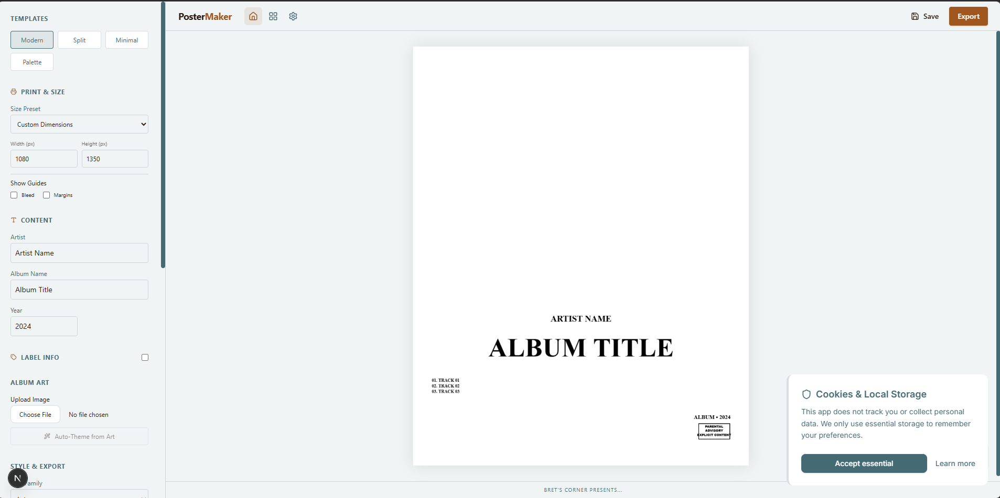

# PosterMaker

A professional, privacy-first web application for designing iconic album posters. Create print-ready artwork directly in your browser with zero data collection, zero accounts, and zero watermarks.



---

## Features

### 🎨 4 Iconic Layout Archetypes
- **Swiss Palette Grid**: Structured 2-column modernist layout with framed artwork, 5 extracted color swatches, ordered tracklist, and signature layer.
- **Brutalist Inset Rule**: Monochromatic editorial paper framed by a fine hairline rule with inline slashed tracklist and high-impact grotesque typography.
- **Cinematic Split**: Upper photographic bleed blending into deep tone paper via baked alpha bottom fade, paired with kinetic blur title echo.
- **Modern Studio**: Edge-to-edge dominant artwork with stacked artist titles, streaming QR code, and parental advisory badge.
- **Deep-Link Launch**: Launch the editor with pre-loaded archetypes and project parameters via URL (e.g. `/editor?template=palette&artist=Echo+Velocity&album=Neo-Construct+04`).

### 🎵 Smart Music Import & Auto-Theming
- **Bulk Tracklist Auto-Parser**: Paste raw track text copied directly from Spotify, Apple Music, Bandcamp, or Wikipedia. Auto-extracts track numbers, titles, and timestamps (`01. Song Title 3:45`) into balanced two-column layouts.
- **5-Color Palette Extraction**: Samples uploaded artwork using client-side median-cut color quantization (ColorThief) to extract 5 dominant swatches.
- **Movable Swatch Group**: Drag, reposition, or restyle color swatches on the canvas with support for square, rounded, or circular shapes.

### 🖼️ Interactive Canvas & Blending
- **On-Canvas Drag & Scale**: Direct manipulation of cover artwork and layout layers via Fabric.js 7.1.
- **Non-Destructive Edge Blending**: Baked alpha bottom fade gradient melts cover artwork smoothly into the poster background without floating overlay glitches.

### 🖨️ 300 DPI Print-Ready Export
- **Standard Frame Sizes**:
  - **ISO A-Series**: A4 ($210 \times 297\text{ mm}$), A3 ($297 \times 420\text{ mm}$), A2 ($420 \times 594\text{ mm}$).
  - **US Retail Frames**: $12 \times 12″$ ($305 \times 305\text{ mm}$ vinyl sleeve), $18 \times 24″$ ($457 \times 610\text{ mm}$ gallery frame), $24 \times 36″$ ($610 \times 914\text{ mm}$ concert tour poster).
- **Multiple Export Formats**: High-resolution PNG, JPG, or Vector PDF at 72, 150, or 300 DPI.
- **Print Proofing**: Toggleable $3\text{ mm}$ bleed margins and $10\text{ mm}$ safe zone guides.

### 🌓 Dark & Light Studio Modes
- **Darkroom Studio**: Deep carbon interface (`#121214`) optimized for visual editing and focus.
- **Gallery Light**: Warm archival linen finish (`#f9f8f5`) for clean editorial evaluation.
- **Persistent Settings**: Theme preference is saved locally and initialized synchronously before hydration to eliminate flash of unstyled theme (FOUT).

### ⚡ HyperFrames Motion Craft
- Landing page interactions choreographed using HyperFrames animation rules:
  - `ambient-glow-bloom`: Subtle radial glow behind the hero triptych.
  - `split-tilt-cards`: 3D perspective viewport with opposing tilt hover reactions.
  - `press-release-spring`: Tactile compression on click and spring recovery on release.
  - Capped group staggers ($\le 0.5\text{s}$) for punchy, unified entrance beats.

### 🔒 100% Private & In-Browser
- **Zero Server Uploads**: All canvas rendering and image downsampling happen locally in browser memory.
- **Zero Analytics / Tracking**: No cookies, no external tracking scripts, and no login required.
- **Local Persistence**: Designs and history saved safely to your browser's Local Storage.

---

## Tech Stack

| Layer | Technology |
| :--- | :--- |
| **Framework** | Next.js 16.1.1 (App Router, Turbopack) |
| **Language** | TypeScript 5, React 19.2.3 |
| **Canvas Engine** | Fabric.js 7.1.0 |
| **Styling** | Tailwind CSS v4 |
| **Motion** | Framer Motion 12.23 (HyperFrames animation craft) |
| **State Management** | Zustand 5.0.9 (with persistent storage) |
| **Icons** | Lucide React |
| **Export Engines** | jsPDF 3.0, Native Canvas API, FileSaver |

---

## Getting Started

### Prerequisites
- Node.js 18.18+ or later
- npm or yarn or pnpm

### Installation

1. **Clone the repository**:
   ```bash
   git clone https://github.com/bretmuchow07/poster-maker.git
   cd poster-maker
   ```

2. **Install dependencies**:
   ```bash
   npm install
   ```

3. **Run the local development server**:
   ```bash
   npm run dev
   ```

4. **Open in browser**:
   Navigate to [http://localhost:3000](http://localhost:3000).

### Build for Production

```bash
npm run build
npm start
```

---

## Project Structure

```
poster/
├── public/                 # Static assets and fonts
├── src/
│   ├── app/                # Next.js App Router pages
│   │   ├── page.tsx        # Modern studio landing page
│   │   ├── layout.tsx      # Root layout, FOUT theme script & metadata
│   │   ├── globals.css     # CSS custom properties & theme tokens
│   │   ├── editor/         # Studio canvas editor route
│   │   └── privacy/        # Privacy policy & terms
│   ├── components/
│   │   ├── landing/        # Header, Hero, Templates, Features, Specs, FAQ, Footer
│   │   ├── editor/         # EditorLayout, CanvasArea, Sidebar, Toolbar
│   │   ├── ThemeToggle.tsx # Accessible Sun/Moon switch
│   │   └── ThemeProvider.tsx # Client-side theme synchronization
│   ├── store/
│   │   └── posterStore.ts  # Zustand store with persistent state & undo/redo
│   └── types/              # TypeScript interfaces and canvas models
├── DESIGN.md               # Architecture specification and design tokens
└── README.md               # Project documentation
```

---

## License

MIT License. Free to use, adapt, and build upon.
